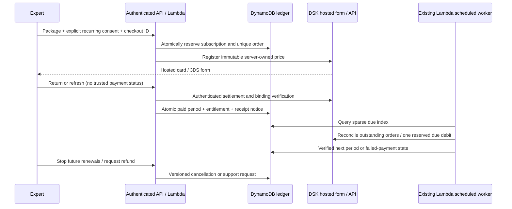

# Expert subscription billing

Status, 8 November 2026: implemented behind default-off server gates; **not certified or enabled for real charging**. Sessions remain outside this payment release. Current evidence is in [payment QA](qa-payments-2026-11-08.md).

## Rules and trust boundaries

- `backend/api/billing.cjs` owns package prices (999/2999/9999 EUR cents), immutable consent and period snapshots. Client amounts, entitlement fields and bank-return parameters cannot grant access. All owner reads use Cognito authorization and owner matching; admin inspection uses the existing admin guard.
- Each checkout is durably reserved before bank registration. Each renewal has one reserved subscription/cycle reference before one debit attempt. A timeout keeps an unresolved record; recovery reads the same bank reference without issuing another debit. Concurrent workers and stale refunds/settlement are guarded by real DynamoDB transactions and versions.
- Only verified captured funds grant a paid interval. A zero-charge recurrent-card setup grants nothing; only its separate, reserved and verified first fee can do so. The first fee is deferred to another invocation if too little Lambda time remains. Common saved cards never enable recurring payments.
- Calendar months preserve the original UTC date/time; short months clamp and the next month restores the original day. UI dates display Sofia time and disclose UTC calculation. No unattended upgrades, price increases or catch-up of multiple missed periods. A renewal missed by more than 24 hours requires customer action.
- Cancellation immediately stops future attempts and keeps the verified paid interval. Already submitted bank actions may settle; UI exposes in-flight status. A paid initial order captured after cancellation/deletion/admin grant goes to refund review rather than granting privileges. Account deletion cancels renewal; cancelling deletion does not restore it.
- Independent comped/granted access is preserved. A refund of an old subscription cannot revoke a replacement subscription. Full confirmed refund revokes only the matching purchased entitlement. Partial refunds and disputes stop renewal and require review.
- Cancelled expired/revoked subscriptions have their saved recurring binding disabled and verified absent. The owner can resume only before expiry with fresh consent and verified recurring binding; no immediate extra fee is taken. Cleanup does not restart billing. A replacement purchase waits for the old recurring binding to be removed, so replacing the subscription cannot orphan a reusable card identifier.
- Card entry/storage is at DSK only. No card inputs or browser/API credentials are embedded in the website. Private binding IDs and bank identifiers are excluded from public profiles/customer DTOs. Admins get the merchant order reference needed for support.

## Support and refunds

The customer panel records a refund/withdrawal request and stops that subscription's future renewals. This is **not a completed refund**. The admin billing queue shows the request and merchant reference. The authorized bank operator reviews and executes the financial refund in the bank portal; the application refreshes authenticated bank status before marking it refunded/revoking the corresponding purchased access. Do not retry an ambiguous financial operation or manually edit paid records to manufacture proof.

The conditional terms offer a full refund on request within 14 days of the first subscription fee and preserve mandatory rights. Later/erroneous charges remain reviewable. This implemented default is not legal approval. Verify sales-document issuance/accounting separately; a bank receipt is not automatically a tax invoice.

## Infrastructure and cost

The existing on-demand users table holds reserved `system#dsk-*` records. One sparse `billing-index` supports owner history, due subscriptions and pending notices; ordinary user profiles are not indexed there. Existing private tables, Lambda, API Gateway, SES and EventBridge are reused. There is no additional always-on server or paid billing SaaS.

The five-minute billing rule is disabled without configured rotated API access. It remains independent of the existing identity/reminder worker. Enabled runs query the sparse index rather than scanning all users; paid records are normally checked hourly and pending orders every five minutes. Admin history uses an on-demand scan. Usage/storage/PITR/email charges still apply; low use is inexpensive, not a guarantee of a zero bill.

Notices use a durable pending index with bounded retries (four attempts) and at-least-once delivery. A crash can duplicate a receipt, never a debit. SES acceptance is not inbox delivery; failed delivery needs operator review. New charges require SES production access and sending enabled.

## Testing and activation

- `npm test`: ordinary regressions, including gateway strictness and activation guards.
- `npm run test:billing:local`: real DynamoDB Local transaction engine with a fake bank, no AWS tables/credentials or bank traffic. Requires Java 17+ and the [official DynamoDB Local archive](https://docs.aws.amazon.com/amazondynamodb/latest/developerguide/DynamoDBLocal.DownloadingAndRunning.html); verify its published checksum. Set `GP_DYNAMODB_LOCAL_JAR` to its JAR, or use the documented local cache. CI downloads and checksum-verifies the official archive. The runner starts an ephemeral loopback-only in-memory server and cleans it up.
- The guarded customer paths are `/me/billing`, `/me/billing/checkout`, `/me/billing/cancel`, `/me/billing/resume` and order refresh/refund requests. `/billing/config` exposes only availability. `/admin/billing` and admin order refresh remain admin-only. Browser returns initiate server verification, not access activation.
- Keep `dsk_live_enabled`, `dsk_live_credentials_rotated`, `dsk_recurring_confirmed` false and dedicated live credentials empty until the relevant evidence exists. Never reuse the exposed API password or operator-portal password. UAT credentials remain separate and empty in deployed Lambda when UAT is off.
- Rotated configured credentials may remain available for reconciliation while new charging is disabled. Do not remove reconciliation access from an already operating ledger without a recovery plan.
- Before activation: resolve DSK recurring-init refusal; test successful/declined/3DS/interrupted first and recurring payments, cancellation, zero-charge setup if applicable and actual refunds through the complete application flow; verify general-recipient notices; approve policies and sales-document process; verify deployed IAM; have the owner perform a bounded real-card payment/refund. Local fixtures cannot substitute for this evidence.

Official references: [DSK REST/recurring API](https://uat.dskbank.bg/sandbox/en/integration/api/rest.html), [DSK recurrent credential types](https://uat.dskbank.bg/sandbox/en/integration/api/binding_types.html). The adapter uses DSK's documented JSON `recurrentPayment.do` outside `/rest/`; status is verified separately.
